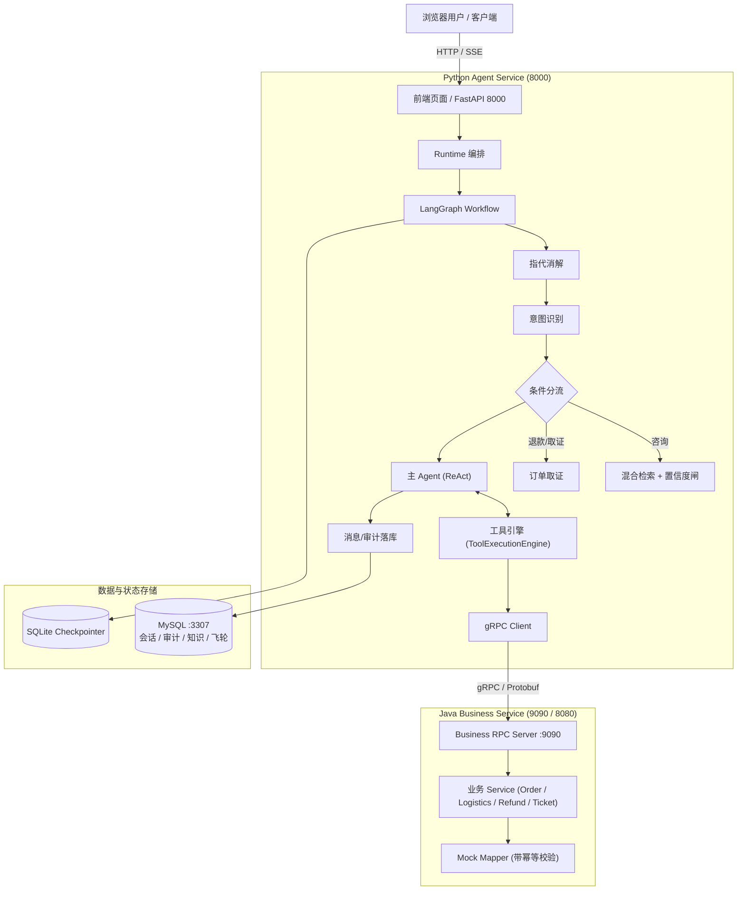

# 灵犀客服

> 面向微服务架构的智能客服系统：Python Agent Service + Java Business Service + 现代化 Web 前端

灵犀客服将 AI Agent 编排与核心电商交易业务解耦拆分：
- **Python Agent Service**：负责自然语言理解、LangGraph 工作流编排、9 类意图识别、指代消解、RAG 混合检索与证据置信度闸、ReAct 工具循环、SSE 流式推送与数据飞轮。
- **Java Business Service**：负责订单归属校验、物流查询、保修与退货状态、退款资格校验、幂等退款提交与人工工单流转，提供稳定的 gRPC RPC 服务。
- **现代化 Web UI**：内置于 Agent 服务的单页应用，提供会话管理、流式对话、二次确认操作卡片、政策检索、飞轮待审处理与 Token 成本看板。
- **全链路 Docker 封装**：通过 `docker-compose.yml` 实现 MySQL、Java 业务服务、Python Agent 服务与前端的一键编排与启动。

---

## 项目结构

```text
lingxi-customer-service/
├── business-service/                 # Java Business Service (Spring Boot + gRPC)
│   ├── src/main/java/com/shangui/userhelp/
│   │   ├── common/                   # 公共错误与 RpcErrorMapper
│   │   ├── business/api/             # 本地 HTTP 调试接口
│   │   ├── order/                    # 订单模块 (domain, mapper, service)
│   │   ├── logistics/                # 物流模块
│   │   ├── aftersales/               # 售后模块
│   │   ├── refund/                   # 退款模块 (内存幂等)
│   │   ├── ticket/                   # 工单模块 (内存幂等)
│   │   └── rpc/                      # gRPC Endpoint 服务端
│   ├── src/main/proto/
│   │   └── business_service.proto   # 跨服务 Protobuf 接口契约
│   ├── Dockerfile                    # 多阶段 Java 镜像构建
│   ├── pom.xml
│   └── README.md
│
├── agent-service/                    # Python Agent Service (FastAPI + LangGraph)
│   ├── app/
│   │   ├── api/                      # REST 与 SSE 路由 (chat, agent, actions, kb, review...)
│   │   ├── core/                     # 核心算法 (intent, coref, retrieval, confidence, memory, flywheel...)
│   │   ├── db/                       # 数据模型 (10张表) 与仓储 (Conversation, Audit, Flywheel, KB)
│   │   ├── graph/                    # LangGraph 工作流 (state, nodes/, routing, build, runtime)
│   │   ├── grpc_client/              # gRPC 客户端适配 (Order, Logistics, Aftersales, Refund, Ticket)
│   │   ├── kb/                       # 知识库管理与对话 QA 采掘
│   │   ├── static/                   # 现代化 Web 前端 (HTML / CSS / JS)
│   │   ├── tools/                    # 工具注册 (registry) 与执行引擎 (engine, builtin/)
│   │   └── main.py                   # FastAPI 应用入口与静态前端挂载
│   ├── scripts/                      # 离线任务 (飞轮批处理, QA采掘, RAG评测, 成本报表)
│   ├── sql/                          # 数据库 DDL (001_agent_core.sql)
│   ├── tests/                        # 全量自动化测试套件 (80 passed)
│   ├── Dockerfile                    # Python 容器构建配置
│   ├── pyproject.toml
│   └── README.md
│
├── docs/
│   ├── SPEC.md                       # 总体服务拆分与接口规格书
│   └── ARCHITECTURE.md               # 系统架构图与时序图
│
├── docker-compose.yml                 # MySQL + Java + Python 全栈容器编排
├── .env.example                      # 环境变量示例
└── README.md
```

---

## 架构图



---

## 快速开始

### 方式一：Docker Compose 一键启动（推荐）

依赖：本地已安装 [Docker](https://www.docker.com/) 与 Docker Compose。

```bash
# 1. 复制环境变量文件（如需使用外部大模型，填写 CHAT_API_KEY）
cp .env.example .env

# 2. 一键构建并启动所有服务 (MySQL, Java Business Service, Python Agent Service)
docker compose up -d --build

# 3. 查看容器运行状态
docker compose ps
```

启动完成后：
- **Web 前端管理界面**：浏览器访问 [http://localhost:8000](http://localhost:8000)
- **FastAPI 接口文档 (Swagger)**：访问 [http://localhost:8000/docs](http://localhost:8000/docs)
- **Java Actuator 健康检查**：访问 [http://localhost:8080/actuator/health](http://localhost:8080/actuator/health)
- **Java gRPC 端口**：监听在 `127.0.0.1:9090`
- **MySQL 数据库**：映射在 `127.0.0.1:3307`

---

### 方式二：本地分步启动开发

#### 1. 启动 Java 业务服务
```bash
cd business-service
mvn spring-boot:run
```
服务将在 `8080` (HTTP) 和 `9090` (gRPC) 启动。

#### 2. 启动 Python Agent 服务
```bash
cd agent-service
# 推荐使用 uv 或虚拟环境
uv run uvicorn app.main:app --host 127.0.0.1 --port 8000 --reload
```
打开浏览器访问 [http://127.0.0.1:8000](http://127.0.0.1:8000) 即可使用智能客服管理界面。

---

## 自动化测试与质量校验

- **Java Business Service 测试**：
  ```bash
  cd business-service
  mvn test
  ```
  *覆盖订单查询、物流、退款幂等、工单创建及错误码映射（8 tests passed，BUILD SUCCESS）。*

- **Python Agent Service 测试**：
  ```bash
  cd agent-service
  uv run pytest
  ```
  *覆盖 API、模型、仓储、LangGraph 完整工作流、gRPC 客户端、工具引擎、置信度闸与 Web UI（80 tests passed）。*

---

## 核心接口调用示例

### 1. SSE 流式聊天
```bash
curl -N -X POST "http://localhost:8000/api/chat/stream" \
  -H "Content-Type: application/json" \
  -d '{"message": "请问订单 1001 的物流到哪了？", "user_id": "u1"}'
```

### 2. 用户操作确认与恢复 (Interrupt / Resume)
```bash
curl -X POST "http://localhost:8000/api/actions/resume" \
  -H "Content-Type: application/json" \
  -d '{"conversation_id": 1, "user_id": "u1", "confirmed": true, "message": "确认申请退款"}'
```

### 3. RAG 知识检索
```bash
curl -X POST "http://localhost:8000/api/kb/search" \
  -H "Content-Type: application/json" \
  -d '{"query": "七天无理由退货要求", "top_k": 3}'
```

---

## 相关文档索引

- [总体架构规格书 (SPEC.md)](docs/SPEC.md)
- [架构图与请求时序 (ARCHITECTURE.md)](docs/ARCHITECTURE.md)
- [Python Agent Service 详细设计规格](agent-service/docs/PYTHON_AGENT_SERVICE_SPEC.md)
- [Java Business Service 详细设计规格](business-service/docs/JAVA_BUSINESS_SERVICE_SPEC.md)
- [十篇模块设计文档目录](agent-service/docs/design/)
