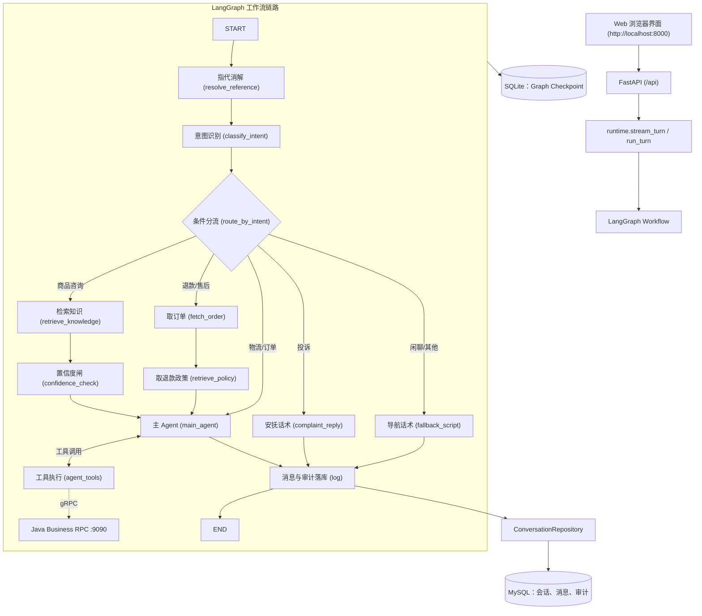

# Python Agent Service

灵犀客服的 Python Agent Service 目录。

## 当前状态

Python Agent Service 已按照分层规格书全面落地，包含以下核心能力：

1. **工作流编排 (LangGraph)**：支持完整的“指代消解 (`resolve_reference`) → 意图分类 (`classify_intent`) → 条件路由 (`route_by_intent`) → 证据检索与置信度闸 (`confidence_check`) / 订单取证 (`fetch_order`) → 主 Agent ReAct 循环 (`main_agent` ⇄ `agent_tools`) → 审计与消息落库 (`log`)”。
2. **业务工具与 gRPC 客户端**：基于 Java 端 Protobuf 协议自动生成代码，实现了统一的 `BusinessClient`，并在 `@tool` 工具层接入订单查询、物流查询、保修/售后查询，以及需要用户二次确认 (`interrupt`/`resume`) 的退款和工单提交。
3. **上下文分层管理**：近期原文、中期规则截短、远期异步摘要三层管理，以中文字符基准统一 Token 预算。
4. **知识治理与数据飞轮**：支持四信号证据置信度闸、低置信度问题收集、标准化与查重、飞轮人工审核 API，以及对话 QA 知识采掘。
5. **接口与前端 UI**：FastAPI 提供 SSE 流式聊天 (`/api/chat/stream`)、标准聊天、确认恢复 (`/api/actions/resume`)、会话管理、知识库、飞轮审核与成本观测接口，并在根路径直接挂载美观的现代 Web 前端。
6. **自动化测试**：全量单元测试与集成测试覆盖（80 passed）。

详细设计见：[Python Agent Service 规格书](docs/PYTHON_AGENT_SERVICE_SPEC.md)。

## 架构与执行链路



## 目录结构

```text
agent-service/
├── app/
│   ├── api/             # FastAPI 路由层（chat, agent, actions, conversations, kb, review, observability）
│   ├── core/            # 核心算法（intent, coref, retrieval, confidence, memory, flywheel, taxonomy）
│   ├── db/              # 数据模型（models/ 包含10张表）与仓储层（repositories/）
│   ├── graph/           # LangGraph 工作流（state, routing, build, runtime, nodes/）
│   ├── grpc_client/     # Java Business gRPC 客户端适配层
│   ├── kb/              # 政策知识库管理与对话 QA 采掘
│   ├── schemas/         # Pydantic 请求响应模型
│   ├── static/          # 现代化 Web 前端页面（HTML, CSS, JS）
│   ├── tools/           # 工具定义 (registry) 与执行引擎 (engine, builtin/)
│   └── main.py          # FastAPI 应用入口与静态资源挂载
├── proto/               # Protobuf 契约副本
├── scripts/             # 离线任务脚本（flywheel_pipeline, mine_knowledge, eval_ch04, cost_by_intent）
├── sql/                 # 数据库 DDL（001_agent_core.sql）
├── tests/               # 单元测试与端到端测试（80 tests）
├── Dockerfile           # Docker 镜像构建配置
├── pyproject.toml
└── README.md
```

## 快速启动

### 方式一：本地运行

```powershell
# 1. 激活环境或使用 uv
uv run uvicorn app.main:app --host 127.0.0.1 --port 8000 --reload

# 2. 浏览器访问前端界面
# http://127.0.0.1:8000
```

### 方式二：Docker 容器运行

见仓库根目录 `docker-compose.yml`，执行 `docker compose up -d` 即可。

### 运行测试

```powershell
uv run pytest
```
